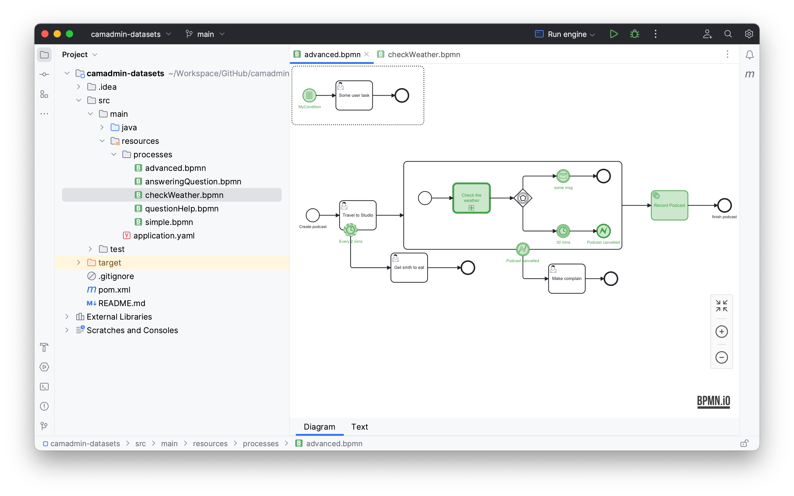

# BPMN & DMN Viewer for IntelliJ IDEA

    

<!-- Plugin description -->

A viewer for BPMN (Business Process Model and Notation) and DMN (Decision Model and Notation) files, right inside the code editor of IntelliJ IDEA. Open a `.bpmn` or `.dmn` file and see the diagram next to its XML source.

## Features

- BPMN diagrams: `.bpmn`, `.bpmn2`, `.bpmn20` (also with a trailing `.xml`), rendered with [bpmn-js](https://github.com/bpmn-io/bpmn-js).
- DMN decisions: `.dmn` files, rendered with [dmn-js](https://github.com/bpmn-io/dmn-js) — the decision requirements diagram, decision tables and literal expressions, each in its own tab. DMN 1.1 – 1.3 are supported.
- Visual diff: compare two versions of a diagram in the IDE's diff window (local changes, history, *Compare With…*). Added, removed, changed and moved elements are highlighted side by side and listed with their attribute changes. Choose **Diagram viewer** in the diff toolbar's viewer chooser to switch from the text diff.
- Interactive viewer: zoom and pan with the mouse, trackpad or the on-screen controls.
- Always up to date: the diagram refreshes when the file is saved.
- Syntax highlighting: the source is highlighted as XML.
- Dark mode: follows the IDE theme.
<!-- Plugin description end -->

## License

This plugin is released under the [MIT License](LICENSE).

[template]: https://github.com/JetBrains/intellij-platform-plugin-template
